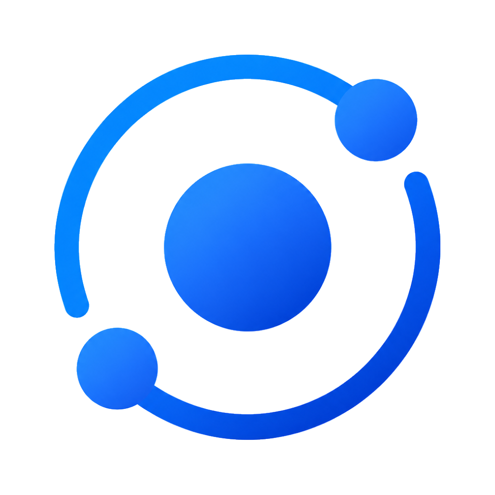

<div align="center">
  
  <h1>Flowlet</h1>
  <p><strong>让多个 AI Agent 共用一个可控、可追溯的本地模型入口。</strong></p>
  <p>一次接入，统一切换；请求失败知道原因，Token 和费用知道花在哪。</p>
</div>

<p align="center">
  <a href="https://github.com/null-object-0000/flowlet/releases"><strong>下载 Flowlet</strong></a>
  ·
  <a href="https://flowlet.snewbie.site">产品官网</a>
  ·
  <a href="https://github.com/null-object-0000/flowlet/issues">反馈问题</a>
</p>

<p align="center">
  <a href="https://github.com/null-object-0000/flowlet/stargazers"></a>
  <a href="https://github.com/null-object-0000/flowlet/releases"></a>
  <a href="LICENSE"></a>
</p>

## Docker 部署

已支持独立服务与浏览器管理界面。准备 `.env` 中的管理凭据和对外地址后，运行 `docker compose up -d --build`；默认 Web 端口 `20134`、模型入口端口 `20135`。
完整步骤、数据卷与功能范围见 [Docker 部署文档](docs/docker.md)。

## 为什么使用 Flowlet

- **告别反复改配置**：Claude Code、OpenCode、Pi 和 Codex 共用一个本地入口，切换渠道或账号不再逐个修改 Agent。
- **把多个账号变成一个服务**：集中管理 LongCat、DeepSeek、Kimi、Qwen、Z.AI、OpenRouter 与自定义渠道，支持多账号候选和失败降级。
- **知道 Agent 真正在做什么**：统一查看请求、原生会话、工具调用、错误、Token、费用和资源余量。
- **数据留在自己手里**：代理、配置、凭据和使用数据默认保存在本机，不依赖 Flowlet 云服务。

## 你可以用它做什么

### 一键接入常用 Agent

Flowlet 可以检测本机安装，并为以下 Agent 写入和恢复全局配置：

`Claude Code` · `OpenCode CLI / Desktop` · `Pi` · `Codex CLI / Desktop / VS Code`

### 统一管理模型与账号

从上游拉取真实模型列表，明确选择需要开放的模型；为同一模型配置多个账号，让 Agent
直接选择该规范模型即可获得多账号候选与失败降级，不再经过聚合别名。

### 看清请求、会话与用量

请求失败时可以看到实际路由、上游响应和错误；日常使用时可以按 Agent、模型、渠道与会话
核对 Token、缓存命中、预估费用、套餐余量和 Codex Credits。

### 桌面设备间同步

使用自有 S3-compatible 存储同步设备用量、会话和 Agent 摘要，并在桌面端按设备查看。
桌面使用 Electron + Node/TS，不再保留 Rust/Tauri 宿主；也可独立部署 Web/Docker Host。

## 开始使用

1. 从 [GitHub Releases](https://github.com/null-object-0000/flowlet/releases) 下载桌面客户端；
2. 添加一个渠道账号，拉取并选择需要开放的模型；
3. 在概览页选择你的 Agent，在接入抽屉中选定默认模型后一键接入 Flowlet；
4. 回到 Agent 正常工作，在 Flowlet 中查看请求、会话和用量。

> [!NOTE]
> 当前主要开发与回归环境是 **Windows 11 原生环境（未启用 WSL）**。macOS 与 Linux
> 版本由 GitHub Actions 自动构建，但尚未完成作者真机回归验证；后续完成对应环境测试后
> 会更新支持状态。Windows 桌面产物尚未签名；macOS DMG 使用 ad-hoc 签名但尚未经过
> Apple 公证，首次启动可能需要按[发布构建说明](docs/release-builds.md#桌面签名说明)手动放行。

## 本地优先

Flowlet 默认只在本机保存渠道 API Key、Client Token、配置和使用数据。多设备 S3 同步是
可选能力。设备快照不携带渠道凭据或代理请求正文，但可包含会话最近一轮交互，
应按敏感数据管理；渠道账号工作区另需显式启用，并使用独立密钥端到端加密。

请求捕获可能包含敏感 Header 和 Body；如果不需要完整排障信息，可以在“设置 → 数据捕获”
中开启敏感 Header 脱敏或关闭相应捕获。

## 了解更多

- [安装与首次使用](docs/installation.md)
- [支持的渠道、模型、协议与 Agent](docs/support-matrix.md)
- [配置与数据保留策略](docs/config.md)
- [更新日志](CHANGELOG.md)

<details>
<summary>从源码运行</summary>

仓库开发使用 Node.js 26 与 npm；桌面运行时由 Electron 提供。构建 ACP 辅助程序还需要 Go（CI 使用 1.27.x），不需要 Rust 工具链：

```bash
git clone https://github.com/null-object-0000/flowlet.git
cd flowlet
npm ci
npm run desktop:dev
# 仅预览前端：npm run dev
# Web 管理台 + Node Host：见 docs/docker.md
```

桌面构建/便携更新见 [Electron 宿主](docs/desktop-electron.md)，发版见 [发布构建](docs/release-builds.md)。
静态命令注册核对运行 `npm run node:commands`；该检查不证明参数或行为覆盖率。
架构与贡献说明见 [架构文档](docs/architecture.md)。

</details>

## License

[MIT](LICENSE)
