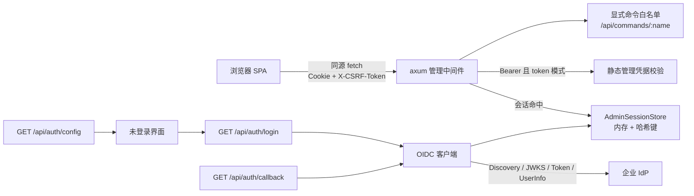
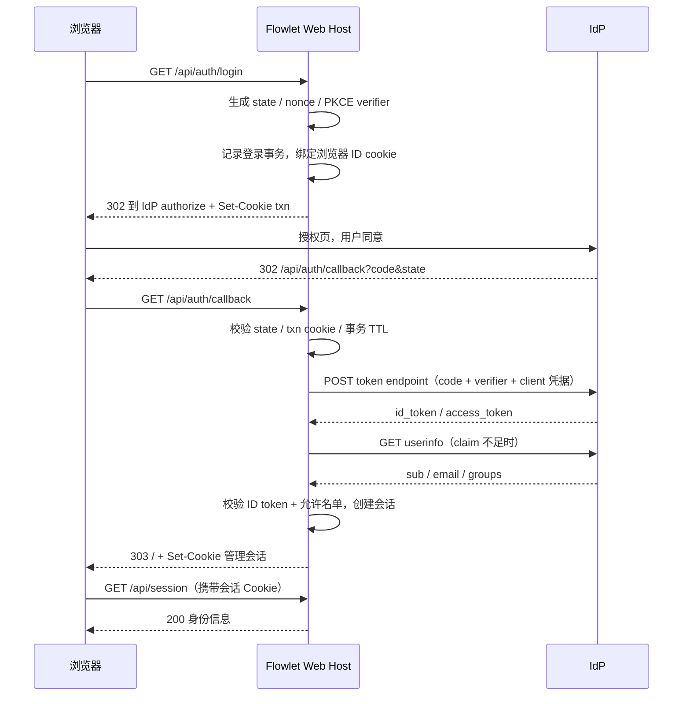

# 管理端 OAuth / OIDC 单点登录设计

状态：**v0.5 已实现并完成真实 GitLab 登录验证（2026-11-09）**；首个 IdP = GitLab，v1 准入使用单用户 `sub`
日期：2026-11-09（v0.2 纳入了规范、各 IdP 与 Rust crate 的实机核验；v0.3 收窄首个 IdP 落地细节）
范围：headless / Docker Web Host 的浏览器管理台（`FLOWLET_WEB_ADDR` 暴露的 Web UI 与
`/api/*` 管理接口）
不在范围：桌面端（Tauri）、模型调用入口鉴权、渠道账号自身的上游 OAuth 登录

---

## 1. 问题与现状

当前 Web 管理台只有一种鉴权方式：部署时写死的静态管理凭据 `FLOWLET_ADMIN_TOKEN`。

代码事实（以当前工作区为准）：

| 环节 | 位置 | 现状 |
| --- | --- | --- |
| 凭据来源 | `src-tauri/src/bin/headless.rs:28-31` | 只读环境变量 `FLOWLET_ADMIN_TOKEN`，要求 ≥24 字符；缺失直接启动失败 |
| 传入 Web Host | `src-tauri/src/bin/headless.rs:101-107` | `WebState { admin_token, ... }` |
| 校验 | `src-tauri/src/core/web/mod.rs:31-47` | `Authorization: Bearer <token>`，HMAC 常数时间比较 |
| 中间件 | `src-tauri/src/core/web/mod.rs:49-71` | 未通过返回 401 JSON，并给所有响应加 `Cache-Control: no-store` |
| 会话探测 | `src-tauri/src/core/web/mod.rs:77-80` | `GET /api/session` 恒返回 `{"authenticated":true}`（因为已过中间件） |
| 浏览器保存 | `src/platform/web/client.ts:1-14` | 凭据存 `sessionStorage`，每次请求带 Bearer |
| 登录界面 | `src/web/WebApp.tsx:82-156` | 单个密码输入框 |
| 部署文档 | `docs/docker.md:16-30,38-44` | 浏览器输入该凭据；凭据只保存于当前标签页 |
| 编排 | `docker-compose.yml:13`、`.env.docker.example:2` | `FLOWLET_ADMIN_TOKEN` 必填 |
| 架构说明 | `docs/architecture.md:111-116` | “管理 API 强制 Bearer 管理凭据并禁止缓存” |
| 命令白名单 | `src-tauri/src/core/web/commands.rs:23-326` | 显式 `match` 白名单，未知命令 501；HTTP 无法调用桌面命令 |

由此产生的实际问题：

1. **只有一把共享凭据**：无法区分是谁登录、离职人员无法单独撤销、无法按人审计。
2. **没有过期**：凭据永久有效，泄露后只能整体更换（并通知所有使用者）。
3. **凭据在 JS 可读存储中**：`sessionStorage` 里的明文凭据可被任意 XSS 读取。
4. **Docker 部署通常暴露在服务器网络上**：静态共享密码是比企业 SSO 明显更弱的一层。
5. 企业/团队环境已有 IdP（飞书、Entra ID、Keycloak、Authentik、Google Workspace 等），
   管理台却要求再维护一套独立密码。

本文设计的就是上面第 1–5 条背后的管理员身份能力（管理台 OIDC/SSO 登录），**不涉及**代理转发和渠道账号。

## 2. 目标与非目标

### 目标

- G1：Web 管理台可用企业 IdP 完成 OAuth 2.0 / OIDC 登录，不需要另设密码。
- G2：OIDC 模式下登录后使用服务端会话 + `HttpOnly` Cookie，浏览器 JS 不再接触任何长期凭据。
- G3：登录身份可判权：只有显式允许的人/域/组能进入，默认拒绝（fail-closed）。
- G4：会话可过期、可注销、可重启后失效；认证事件可审计（谁、何时、成功与否）。
- G5：OIDC 不可用时保留明确的运维兜底路径（break-glass），不会把部署者锁在门外。
- G6：不破坏现有 token 模式；默认行为与现在完全一致，升级不改变未配置 OIDC 的部署。
- G7：不改变代理链路、模型调用凭据、SQLite schema 与 `config.json` 语义。

### 非目标（v1 明确不做）

- N1：不做 SAML、LDAP、SCIM、Kerberos 等其它企业认证协议。
- N2：不做多租户/多组织隔离；登录者仍是“这一台 Flowlet 的管理员”。
- N3：不做 RBAC 细粒度角色（v1 只有一个 admin 角色；设计见 8.4 预留）。
- N4：不做多 IdP 同时在线与登录页选择器（v1 一个部署一个 IdP）。
- N5：不做 IdP 反向通道登出（back-channel logout）与令牌撤销联动。
- N6：不做会话的跨副本共享（当前是单实例部署；见 7.2 与 13）。
- N7：不把 IdP 的 access token / refresh token 存进 Flowlet；登录后不再依赖 IdP。
- N8：桌面端不接入 SSO（桌面端是用户本机进程，没有管理 HTTP 端口）。

### 2.1 已确认决策（2026-11-09）

- **首个（也是 v1 唯一）IdP：GitLab**（目标实例 `git.17usoft.com`，CE 10.8.7 + 定制 OIDC）。
  若 5.7.1 门禁确认行为符合标准 OIDC 则不写专用 adapter；否则按 5.7.8 降级。
- **判权依据：单用户 `sub`（v1）**；多人时再切 GitLab `groups`（完整路径）。邮箱/域名只作展示
  与辅助，不作为主依据（GitLab 用户的 `email` 取决于其是否设置公开邮箱）。
- **联调基线**：公司实例 `https://git.17usoft.com`（GitLab CE 10.8.7 + 定制 OIDC；issuer 为
  `http://git.17usoft.com`，端点均为 https，scope 只有 `openid` 等）。**M0 真实应用门禁已于
  2026-11-09 通过**：id_token/RS256 签名、iss/aud/nonce、userinfo.sub、groups、email 均正常，
  可按标准 OIDC 路径实现（结果见 5.7.1）。Gitea/Forgejo 属同构兼容候选，不作为首个验收目标。
- **部署形态（已确认）**：v1 管理台使用现有 `http://10.100.217.60:20134`，不配 HTTPS
  反向代理；接受 Cookie 无 `Secure`/`__Host-`、仅限可信内网的风险（见 5.5、7.1、13）。
- **GitLab 应用（已确认）**：使用你个人的 user-owned 应用（单管理员）。应用归属个人
  **不是访问控制**——任何 GitLab 用户都可能对 client_id 发起授权；准入必须由
  `FLOWLET_OIDC_ALLOWED_SUBS=<你的 sub>` 强制。个人账号失效风险用 break-glass 兜底，
  后续可换组级/实例级应用。
- **不在 v1**：飞书（专有 OAuth2，需 Phase 2 专用 adapter）、GitHub、Bitbucket（无 OIDC provider）。
- 其余产品取舍（token 兜底、会话重启失效、RBAC）仍按 14 节开放问题确认。

## 3. 方案选型

### 备选 A：把鉴权完全交给反向代理（oauth2-proxy / Traefik ForwardAuth / Nginx `auth_request`）

优点：零 Rust 代码；企业已有代理生态。
缺点：Flowlet 自己不知道登录者是谁，页面无法展示身份、无法做应用层授权与审计；
运维必须额外部署一个组件并正确配置 Cookie 域；LAN IP 直连（不带代理）会绕过认证，
需要在服务端仍保留一层凭据校验。**结论：不能替代应用层鉴权，但可作为外层的额外防护；
文档中作为可选加固而不是主方案。**

### 备选 B：内建 OIDC 授权码登录 + 服务端会话（选定）

- 浏览器拿不到 IdP token，token 交换与校验全部在 Rust 服务端完成。
- 服务端签发自己的随机会话 Cookie，认证与授权解耦，退出/过期都在 Flowlet 内部闭环。
- 登录者是 `sub` + email + groups 等 claim，可展示、可审计、可做允许名单。
- 只依赖标准 OIDC Discovery / JWKS / Token Endpoint 与 UserInfo，不绑定厂商 SDK。

与“前端 PKCE 公共客户端”方案相比：该方案不需要把 access token 暴露给浏览器，
不需要前端承担令牌续期，XSS 面更小；代价是服务端必须正确实现 ID token 校验（见 6.4）。

**结论：采用备选 B，命名空间与鉴权边界放在 `core/web/auth`，只服务 Web Host。**

## 4. 总体架构



认证与授权分层（沿用现有边界，不引入第二套状态机）：

1. **认证入口**（`/api/auth/*`）：token 形态（现有静态凭据）或 OIDC 形态（v1 二选一）。
2. **管理会话**：认证成功后统一变成服务端会话；`/api/commands/*` 与其它管理 API 只认会话
   （token 模式下继续兼容 Bearer，见 7.5）。
3. **命令白名单**：不变，仍是 `commands.rs` 的显式 `match`；认证只决定“能不能进来”，
   不改变“能调用哪些命令”。

登录时序：



## 5. 认证模式与配置

### 5.1 模式

| `FLOWLET_ADMIN_AUTH_MODE` | 行为 |
| --- | --- |
| `token`（默认） | 与当前完全一致：`FLOWLET_ADMIN_TOKEN` 必填，浏览器 Bearer 登录 |
| `oidc` | OIDC 登录 + Cookie 会话；默认拒绝 Bearer；`FLOWLET_ADMIN_TOKEN` 可选 |

OIDC 模式下可显式打开兜底：`FLOWLET_ADMIN_ALLOW_TOKEN_LOGIN=1` 时，同时接受
`FLOWLET_ADMIN_TOKEN` 的 Bearer 登录（仅用于紧急运维，文档要求平时关闭）。

### 5.2 环境变量（v1 全部走环境变量，不改 `config.json`）

| 变量 | 默认值 | 说明 |
| --- | --- | --- |
| `FLOWLET_ADMIN_AUTH_MODE` | `token` | `token` 或 `oidc` |
| `FLOWLET_ADMIN_TOKEN` | 空 | token 模式必填（≥24 字符，现有规则）；oidc 模式仅在兜底时必填 |
| `FLOWLET_ADMIN_ALLOW_TOKEN_LOGIN` | `0` | OIDC 模式下是否允许 Bearer 兜底 |
| `FLOWLET_PUBLIC_WEB_URL` | 空 | OIDC 模式必填；浏览器访问管理台的绝对地址（含 scheme，不含结尾 `/`），用于 `redirect_uri` 与登录后跳转 |
| `FLOWLET_OIDC_ISSUER` | 空 | OIDC 模式必填；IdP issuer（如 `https://keycloak.example.com/realms/flowlet`）；必须与 discovery 返回值逐字一致，Entra 只能用具体 tenant |
| `FLOWLET_OIDC_DISCOVERY_URL` | 空 | 可选；非标准 discovery 路径时覆盖；issuer 为 http 时必填且必须是 https |
| `FLOWLET_OIDC_CLIENT_ID` | 空 | OIDC 模式必填 |
| `FLOWLET_OIDC_CLIENT_SECRET` | 空 | confidential client 必填（`CLIENT_AUTH=none` 时忽略） |
| `FLOWLET_OIDC_CLIENT_SECRET_FILE` | 空 | 可选；从文件读取 client secret（Docker secret / 不落 env） |
| `FLOWLET_OIDC_CLIENT_AUTH` | `client_secret_basic` | `client_secret_basic` / `client_secret_post` / `none` |
| `FLOWLET_OIDC_SCOPES` | `openid` | 空格分隔；按 IdP 的 `scopes_supported` 添加（旧版 GitLab 只有 `openid`；标准实例可加 `email profile`） |
| `FLOWLET_OIDC_DISPLAY_NAME` | `企业 SSO` | 登录页按钮文案 |
| `FLOWLET_OIDC_EMAIL_CLAIM` | `email` | 身份邮箱 claim 名；Entra 托管用户默认缺 `email`，可改 `preferred_username`（注意其可变性） |
| `FLOWLET_OIDC_NAME_CLAIM` | `name` | 展示名 claim 名（缺失回退 `preferred_username`） |
| `FLOWLET_OIDC_GROUPS_CLAIM` | `groups` | 组 claim 名（数组或空格分隔字符串） |
| `FLOWLET_OIDC_ALLOWED_EMAILS` | 空 | 逗号分隔精确邮箱（大小写不敏感；email claim 可变，见 6.6） |
| `FLOWLET_OIDC_ALLOWED_DOMAINS` | 空 | 逗号分隔邮箱域，`@` 后精确匹配 |
| `FLOWLET_OIDC_ALLOWED_GROUPS` | 空 | 逗号分隔组名，任一命中即通过 |
| `FLOWLET_OIDC_ALLOWED_SUBS` | 空 | 逗号分隔精确 `sub`（高保障钉住；跨 IdP 重建账号会变，日常不建议） |
| `FLOWLET_OIDC_ALLOW_ANY` | `0` | 显式允许“任何能通过 IdP 登录的人”，与允许名单互斥使用 |
| `FLOWLET_OIDC_REQUIRE_EMAIL_VERIFIED` | `1` | claim 存在且为 false 时拒绝；claim 缺失不拒绝（Authentik ≥2025.10 默认发 false，需其侧配置或改 0） |
| `FLOWLET_OIDC_SIGNING_ALGS` | `RS256,PS256,ES256` | ID token 允许的 JWS 算法（永不包含 `none`/`HS*`） |
| `FLOWLET_OIDC_REDIRECT_URL` | 空 | 覆盖 `redirect_uri`；默认 `${FLOWLET_PUBLIC_WEB_URL}/api/auth/callback` |
| `FLOWLET_OIDC_CA_FILE` | 空 | 可选；内网自签 CA 的 PEM，仅用于访问 IdP 的 HTTP 客户端 |
| `FLOWLET_OIDC_ALLOW_HTTP_ISSUER` | `0` | 允许 issuer 为 http（旧自建 GitLab 的 `external_url` 误配为 http）；此时必须显式写 https 的 `FLOWLET_OIDC_DISCOVERY_URL`，且 discovery 端点必须 https；启动时必须告警 |
| `FLOWLET_OIDC_PKCE` | `auto` | `auto`：discovery 声明 S256 才发送；`required`：未声明则启动失败；`off`：从不发送（仅用于不支持 PKCE 的旧 IdP） |
| `FLOWLET_OIDC_NONCE` | `required` | `required`：ID token 必须回传 nonce 且匹配；`best_effort`：回传则必须匹配、缺失则告警放行（仅旧 IdP）；`off`：不发送 |
| `FLOWLET_OIDC_INSECURE_HTTP` | `0` | 仅本地开发：允许 http issuer 与 http 端点；生产禁止 |
| `FLOWLET_ADMIN_SESSION_IDLE_MINUTES` | `30` | 空闲超时（OWASP 建议 15–30 分钟） |
| `FLOWLET_ADMIN_SESSION_TTL_HOURS` | `8` | 绝对超时（OWASP 建议 4–8 小时） |
| `FLOWLET_ADMIN_COOKIE_SECURE` | `auto` | `auto` 按 `FLOWLET_PUBLIC_WEB_URL` 的 scheme；`always`/`never` 覆盖 |

GitLab 首期推荐取值（含 `FLOWLET_OIDC_SIGNING_ALGS=RS256`、`ALLOWED_SUBS`/组名单）见 5.7.4。
实现时新增 `.env.docker.example` 注释样例，并在 `docs/docker.md` 的环境变量表中登记；
`docker-compose.yml` 把 `FLOWLET_ADMIN_TOKEN` 从“必填”改为“可空，由模式校验”。

### 5.3 启动期校验（fail-closed）

启动时（`bin/headless.rs`，在启动代理之前）校验配置，错误信息必须具体且不含 secret：

- 模式非法 → 启动失败。
- `token` 模式：`FLOWLET_ADMIN_TOKEN` 长度 <24 → 启动失败（保持现有行为）。
- `oidc` 模式：
  - `FLOWLET_PUBLIC_WEB_URL` 必须是绝对 `http(s)` 地址、无查询串/片段、不以 `/` 结尾；
  - `FLOWLET_PUBLIC_WEB_URL` 为 http 时允许启动（v1 目标部署），但必须记录显式告警：
    会话 Cookie 无 `Secure`，仅限可信内网；不得静默按 https 处理；
  - `FLOWLET_OIDC_ISSUER` 必须是绝对地址；默认要求 https。仅当 `ALLOW_HTTP_ISSUER=1`
    允许 http issuer（旧版自建 GitLab 的 `external_url` 为 http 时，discovery 的 issuer
    就是 http），且此时必须显式配置 **https** 的 `FLOWLET_OIDC_DISCOVERY_URL`；
    `INSECURE_HTTP=1` 只用于本地开发（允许 http issuer 与 http 端点，启动必须告警）；
  - discovery 返回的 `authorization_endpoint`/`token_endpoint`/`userinfo_endpoint`/`jwks_uri`
    必须是 https（`INSECURE_HTTP=1` 除外）；
  - `FLOWLET_OIDC_PKCE=required` 时 discovery 必须声明 `code_challenge_methods_supported`
    含 `S256`，否则启动失败；`auto` 未声明时不发送 PKCE 并告警；
  - `CLIENT_ID` 非空；`CLIENT_AUTH != none` 时 `CLIENT_SECRET` 非空；
  - 允许名单至少一项（email/domain/group/sub），否则必须显式 `ALLOW_ANY=1`；两者都空 → 启动失败
    （避免“任何有该公司账号的人都能进管理台”的静默开放）；
  - 会话 TTL/空闲时间关系合法（空闲 ≤ 绝对）；
  - `ALLOW_TOKEN_LOGIN=1` 时 `FLOWLET_ADMIN_TOKEN` 仍需 ≥24 字符。
- 校验失败不启动代理和 Web 监听，直接退出并打印可操作的错误；不写半初始化状态。

### 5.4 IdP 侧注册要求

- 应用类型：Web / confidential client（有 `client_secret`），回调地址
  `${FLOWLET_PUBLIC_WEB_URL}/api/auth/callback`（无 fragment，IdP 侧逐字登记）。
- 必须开启授权码流程；PKCE 按 `FLOWLET_OIDC_PKCE` 决定：discovery 声明 S256 时发送
  （RFC 9700 推荐），旧 IdP 未声明时 `auto` 不发并告警。
- v1 只支持默认 `response_mode=query`；IdP 若强制 `form_post`，登录会以
  `provider_unavailable` 失败并在日志提示（后续再支持 `None; Secure` Cookie 的 post 模式）。
- 至少需要 `openid` scope；`profile`/`email` 视 IdP 支持与展示需求添加（旧版 GitLab 的
  scope 列表没有 profile/email，不能请求；GitLab 的 `openid` scope 本身已含读取用户资料与
  组成员关系）。组判权还需要 IdP 把组/角色 claim 下发到 ID token 或 UserInfo（各家常要单独
  配置 mapper/claim；Entra 超过组上限会走 overage claim，按拒绝处理）。
- Entra ID 必须使用具体 tenant 的 issuer（形如
  `https://login.microsoftonline.com/<tenant-id>/v2.0`），不接受 `common`/`organizations`
  这类多租户 issuer（v1 不做 discovery issuer 模板解析）。
- GitLab（GitLab.com / Self-Managed / Dedicated）与较新的 Gitea / Forgejo 属于标准 OIDC，
  直接走本设计、无需专用 adapter；GitLab OAuth 应用务必勾选 `openid` scope（否则只是
  普通 OAuth2，没有 ID token），并建议用 `groups` 名单而不是依赖用户公开邮箱（见 5.6）。
- 不接受只提供 OAuth2、没有 ID token / 标准 discovery 的服务（GitHub、飞书、Bitbucket），见 5.6。

### 5.5 部署形态：管理台使用 HTTP（已确认）

**已确认（2026-11-09）：v1 管理台直接使用 `http://10.100.217.60:20134`，不配置 HTTPS 反向代理。**

- GitLab 侧：目标实例的 authorization/token/userinfo 端点本来就是 https，浏览器 ↔ GitLab 仍是
  TLS；只有浏览器 ↔ Flowlet 管理台是 http。
- 代价：`FLOWLET_PUBLIC_WEB_URL` 为 http 时会话 Cookie 不带 `Secure`、不能使用 `__Host-`，
  身份与 Cookie 在局域网内可被嗅探。接受范围是**可信内网**；不需要 HTTPS 不等于可以暴露公网，
  必须用防火墙/安全组限制 20134 的来源地址。
- 补偿：短会话（空闲 30 分钟 / 绝对 8 小时）、默认关闭 token 兜底、登录审计、管理口不映射公网；
  将来若要跨网段/公网访问，再补 HTTPS 反代——届时只改 `FLOWLET_PUBLIC_WEB_URL` 与 Cookie 名。
- `Origin` 校验只接受 `http://10.100.217.60:20134` 这一个 origin；用户必须用这个地址访问，
  用其它 IP/主机名访问会被 403（v1 不做多 origin 白名单）。
- v1 不支持反向代理子路径（SPA 以 `/`、`/api/*` 为基准），`FLOWLET_PUBLIC_WEB_URL` 不允许带路径。

目标实例（`git.17usoft.com`）仍有两个必须处理的差异：issuer 是 http（端点 https）→
`FLOWLET_OIDC_ALLOW_HTTP_ISSUER=1` + https discovery；GitLab CE 10.8.7 上的 OIDC 是定制实现 →
按 5.7.1 的 M0 门禁验证，通过前不做标准行为假设。

### 5.6 IdP 兼容性矩阵

（2026-11-09 对规范、各 IdP 官方文档与元数据实机核对；GitLab.com 与 Codeberg 的 discovery
已实测。实现前再按当日文档复核字段与端点；实现只承诺标准 OIDC Discovery + ID Token +
UserInfo 回退。）

| IdP | 形态 | 关键差异与注意事项 | v1 支持 |
| --- | --- | --- | --- |
| Keycloak | 标准 OIDC | discovery `/{root}/realms/{realm}/.well-known/openid-configuration`；`groups` 需 protocol mapper/scope；`end_session_endpoint` 的 `post_logout_redirect_uri` 需在客户端登记（v1 不调用）；自签 CA 用 `FLOWLET_OIDC_CA_FILE` | 支持 |
| Authentik | 标准 OIDC | discovery `/application/o/{slug}/.well-known/openid-configuration`；`groups` 默认随 `profile` 下发；**`email_verified` 自 2025.10 默认 false**，默认策略会拒绝，需在 Authentik 侧标记验证或设 `FLOWLET_OIDC_REQUIRE_EMAIL_VERIFIED=0` | 支持 |
| Entra ID | 标准 OIDC | discovery 含 tenant 段；**issuer 必须是具体 tenant（不能 `common`/`organizations`）**；discovery 可能缺 `code_challenge_methods_supported`，不能据此关 PKCE；`email` 托管用户默认不下发，需 optional claim（或改 `preferred_username`，注意可变）；`groups` 可选，超过 200 组走 overage claim → fail-closed 拒绝并提示；自定义签名密钥会改 `jwks_uri`（用 discovery 返回值） | 支持（需配 claim） |
| Google Workspace | 标准 OIDC | discovery 的 `issuer` 以解析值为准（文档存在两种写法）；`email_verified` 可用；**不支持 groups claim**（需 Admin SDK，非 Flowlet 职责）；建议用 `hd` claim 做 Workspace 域限制（v1 未实现，用邮箱域 + `email_verified` 等价覆盖）；无 `end_session_endpoint` | 支持（仅个人身份/邮箱域判权） |
| Okta | 标准 OIDC | org AS 或自定义 AS 的 discovery 路径不同；仅 RS256；`groups` 需 groups claim/filter；`email_verified` 可用 | 支持（需配 claim） |
| Auth0 | 标准 OIDC | **issuer 带结尾 `/`**，配置必须逐字一致；ID token 算法可能含 HS256，务必收窄 `FLOWLET_OIDC_SIGNING_ALGS`；自定义 claim 必须命名空间化；登出为 `/v2/logout`（非标准，v1 不调用） | 支持（需配 claim） |
| GitLab（GitLab.com / Self-Managed / Dedicated） | 标准 OIDC | discovery `https://<instance>/.well-known/openid-configuration`（GitLab.com 为 `https://gitlab.com/...`，issuer `https://gitlab.com`）；OAuth 应用必须勾选 `openid` scope（可再加 `profile`/`email`）；仅 RS256，PKCE 支持 `plain`/`S256`，token 认证 `client_secret_basic`/`post`；`groups`/`groups_direct` 由 **userinfo** 提供（ID token 通常不含，走 6.5 回退），值为组完整路径（如 `group/subgroup`）；**`email`/`email_verified` 仅当应用有 `email` scope 且用户设置了公开邮箱**，否则缺失（邮箱域名单不可靠，建议用组名单）；另有 `https://gitlab.org/claims/groups/{owner,maintainer,developer}` 角色 claim；无 `end_session_endpoint`（v1 不调用）；自建实例先访问 discovery 验证 | **v1 首个目标**（组名单） |
| Gitea / Forgejo（含 Codeberg） | 标准 OIDC（较新版本） | discovery `https://<instance>/.well-known/openid-configuration`；scopes `openid profile email groups`；claims 含 `email`、`email_verified`、`groups`；仅 RS256；token 端点一般用 `client_secret_post`（discovery 可能不声明 auth methods，按 post 配置）；自建实例先验证版本与 discovery；功能由上游版本决定，旧版本可能没有 OIDC provider | 支持（需较新版本） |
| 飞书 / Lark | **非 OIDC**（专有 OAuth2，无 discovery/ID token/JWKS） | 授权 `https://accounts.feishu.cn/open-apis/authen/v1/authorize`；token `https://accounts.feishu.cn/oauth/v3/token`（v2 旧端点 `open.feishu.cn/.../authen/v2/oauth/token`）；userinfo `https://open.feishu.cn/open-apis/authen/v1/user_info`；仅 confidential client，`client_secret_post` 风格，授权码 5 分钟单次；**email/手机号为管理员导入、非用户自证，不能直接当登录凭据**；`open_id` 是 app 维度标识 | **v1 不支持**；如后续必须接飞书，按 Phase 2 增加专用 provider adapter（授权/token/userinfo，工期 +1–2 天） |
| GitHub | **非 OIDC**（OAuth2，无 ID token/discovery） | 仅授权码 + PKCE S256（不支持 plain）；用户信息走 `/user` + `/user/emails` | 不支持 |
| Bitbucket | **非 OIDC**（OAuth2） | 无 OIDC discovery/ID token；用户信息走 `/2.0/user`（仅消费端 OAuth2） | 不支持 |

结论：**v1 首个目标为 GitLab（组名单）；Gitea/Forgejo 属同构兼容候选，抽测即可；
GitHub、Bitbucket 不能作为 IdP。** GitLab 的 `groups` 来自 userinfo 且是完整路径，
判权时按完整路径精确匹配（例如 `platform/flowlet-admins`），不要只写组名前缀。

### 5.7 GitLab 接入手册（v1 首个 IdP）

#### 5.7.1 目标实例实测与前置条件

**目标实例：`https://git.17usoft.com`（公司 GitLab）。** 2026-11-09 实测 discovery
（`/.well-known/openid-configuration`）关键字段：

```json
{
  "issuer": "http://git.17usoft.com",
  "authorization_endpoint": "https://git.17usoft.com/oauth/authorize",
  "token_endpoint": "https://git.17usoft.com/oauth/token",
  "userinfo_endpoint": "https://git.17usoft.com/oauth/userinfo",
  "jwks_uri": "https://git.17usoft.com/oauth/discovery/keys",
  "scopes_supported": ["api", "read_user", "sudo", "read_repository", "openid"],
  "response_modes_supported": ["query", "fragment"],
  "token_endpoint_auth_methods_supported": ["client_secret_basic", "client_secret_post"],
  "id_token_signing_alg_values_supported": ["RS256"],
  "claims_supported": ["iss","sub","aud","exp","iat","name","nickname","email","email_verified","website","profile","picture","groups"]
}
```

与通用 GitLab 样例的差异与对策：

| 实测点 | 影响 | 对策 |
| --- | --- | --- |
| `issuer` 是 **http**，其余端点 https | 通用 https issuer 校验会拒绝；ID token 的 `iss` 是 http | `FLOWLET_OIDC_ISSUER=http://git.17usoft.com` + `FLOWLET_OIDC_ALLOW_HTTP_ISSUER=1` + `FLOWLET_OIDC_DISCOVERY_URL=https://git.17usoft.com/.well-known/openid-configuration` |
| `scopes_supported` 只有 `openid` 等，**没有 `profile`/`email`** | 请求 profile/email 会 `invalid_scope` | `FLOWLET_OIDC_SCOPES=openid`；该实例应用页的 openid 说明已含“读取用户资料与组成员关系” |
| discovery **没有 `code_challenge_methods_supported`** | 无法确认 PKCE 支持，强行发送可能导致换 token 失败 | `FLOWLET_OIDC_PKCE=auto`（未声明时不发）；联调成功后可临时 `required` 复验；升级 GitLab 声明后 auto 自动启用 |
| 无 `email`/`profile` scope，`email` claim 可能不下发 | 邮箱/域名名单不可靠 | 组名单 + 展示回退 `preferred_username`（见 8.1） |
| `response_modes_supported` 只有 query/fragment | 无影响 | v1 只用 query |
| 实例版本偏旧（应用页只有 api/read_user/sudo/read_repository/openid） | `groups` 是否真的出现在 userinfo 需实测 | M0 用真实应用完成一次 token 交换并检查 userinfo 是否含 `groups`；若不含需升级 GitLab 或改用 `sub` 名单 |

**版本信息冲突（重要风险）**：你报告的版本是 **GitLab Community Edition 10.8.7（revision
eb600b0）**，但 GitLab 10.8.7 官方**没有 OIDC provider**；本实例实测的 discovery 结构、
`/oauth/userinfo`（401）、`/oauth/discovery/keys`（RSA JWKS）与 `scopes_supported` 都来自
doorkeeper-openid_connect 风格的 OIDC 实现。因此只有三种解释：

1. 版本号来源有误（例如看的是别的实例/组件），实例其实是较新 GitLab；
2. 17usoft 在 10.8.7 的定制 fork 上集成了 OIDC（自定义代码，行为不受上游文档保证）；
3. 前端 nginx/网关把 `/oauth/*` 转发到了独立的 OIDC 服务。

**M0 门禁（真实应用 + 真实浏览器，缺一不可）**：

| 检查 | 通过标准 | 不通过时 |
| --- | --- | --- |
| token 端点 | 返回 JSON 且含 `id_token`（不只是 `access_token`） | 退化为《OAuth2 + userinfo 通用 adapter》（Phase 2 提前，+1–2 天），或升级 GitLab |
| ID token `iss` | 等于 `http://git.17usoft.com`，`aud` 含 client_id | 若 issuer 不一致且无法配置，回到版本/配置排查 |
| `nonce` | ID token 回传 nonce 且与事务一致 | 只能 `FLOWLET_OIDC_NONCE=best_effort`（记录告警），或升级 |
| `sub`（单用户门禁） | id_token 有 `sub`，且与 userinfo `sub` 一致（若 userinfo 返回） | 用 `ALLOWED_SUBS`；userinfo 缺 sub 不影响 id_token sub 判权 |
| userinfo `groups`（仅组名单模式） | 返回完整组路径数组，且命中 `ALLOWED_GROUPS` | 单用户 v1 不依赖；要用组名单时不下发则升级 GitLab 或退回 `sub` |
| PKCE | `FLOWLET_OIDC_PKCE=auto` 下不发送也能换 token；若实例支持则开启 | 保持 auto/off 记录风险 |
| 登录闭环 | 浏览器 303 回 `/`，`/api/session` 有身份，非组员被 `allowlist_denied` | 按失败阶段定位，不降级为“只要能登录就放行” |

门禁不通过时向上升级决策，不允许在实现里静默放宽校验（尤其是跳过 `id_token`/`nonce`/组判权）。

**M0 门禁实测结果（2026-11-09，真实应用 + 浏览器，PASS）**：

- token 端点：`client_secret_basic` 可用；响应含 `id_token`（RS256，`kid` 可解析）与 `access_token`；
- ID token：JWKS 验签通过；`iss=http://git.17usoft.com` 逐字一致；`aud=client_id`；
  `nonce` 回传且与请求一致；`exp/iat/auth_time` 正常；`sub` 为 64 位十六进制字符串；
- userinfo（HTTP 200）：`sub` 与 ID token 完全一致；返回 `name`、`nickname`、
  `email` + `email_verified=true`、`groups`（6 个组，完整路径）——**email 与 groups 均来自
  userinfo，ID token 里只有 `sub`**；
- scope 只请求 `openid`：`email`/`groups` 仍可通过 userinfo 获取，不需要 `profile`/`email` scope；
- 未发送 PKCE 也能完成换 token（discovery 未声明 S256，与 `PKCE=auto` 行为一致）；
- 探测脚本结论：**全部通过，可按标准 OIDC 路径实现**。

> 实测的 `sub`/邮箱/姓名属于个人标识，**不写入仓库**；部署时填入
> `FLOWLET_OIDC_ALLOWED_SUBS`（由 `scripts/gitlab-oidc-probe.mjs --show-identifiers` 输出）。
> 5.7.8 的降级方案本次未触发，保留给其它 IdP/实例。

**辅助工具（dev-only）**：`scripts/gitlab-oidc-probe.mjs`（零依赖，不参与前端构建）用于跑上面
的门禁：`--discovery` 只读元数据；完整模式会起本地回调、走授权码、解出 id_token 的
iss/aud/nonce/签名，并打印 userinfo 的 groups（token 只打印前缀长度，邮箱打码）。用组名单时加 `--require-groups` 让 groups 缺失成为失败项；M0 通过后可以删除该脚本。

前置条件：

- 管理台地址（`FLOWLET_PUBLIC_WEB_URL`）浏览器可达；v1 为 `http://10.100.217.60:20134`（见 5.5）；
- 准入组（例如 `platform/flowlet-admins`）已建好，成员由 GitLab 组管理，Flowlet 不维护用户表；
- 自建实例先跑下面的 discovery `curl`，确认 OIDC provider 存在（404/HTML = 版本过旧）：

  ```bash
  curl -sS https://git.17usoft.com/.well-known/openid-configuration | jq \
    '{issuer, authorization_endpoint, token_endpoint, userinfo_endpoint, jwks_uri,
      id_token_signing_alg_values_supported, scopes_supported, code_challenge_methods_supported}'
  ```

#### 5.7.2 GitLab 侧创建 OAuth 应用

v1 已确认使用**个人 user-owned 应用**（单管理员，改动最小）；组级/实例级作为后续多人或
离职保障的升级选项：

- 个人级（v1）：avatar → Edit profile → Applications → Add new application；
  只适合“Flowlet 管理员与 GitLab 账号是同一人”；人员离职/账号失效后应用不可用（break-glass 兜底）；
- 组级（后续）：目标组 → Settings → Applications；
- 实例级（后续，Self-Managed）：Admin → Applications；可勾选 **Trusted** 跳过授权确认页。
- **重要**：应用归属个人**不等于只有你能登录**。任何 GitLab 用户都可能对 client_id 发起授权；
  准入必须由 Flowlet 的 `ALLOWED_SUBS`（v1）或组名单强制，不要依赖应用归属做访问控制。

填写：

| 字段 | 值 |
| --- | --- |
| Name | `Flowlet Admin` |
| Redirect URI | `http://10.100.217.60:20134/api/auth/callback`（v1 目标地址，需实测 GitLab 是否接受 http；逐字一致：scheme/端口/路径，无 fragment）。将来上 HTTPS 时改为 `https://<domain>/api/auth/callback` |
| Scopes | **只勾 `openid`**（本实例应用页的 openid 说明已含“读取用户资料与组成员关系”）；不要勾 api/sudo/read_repository；`read_user` 非必需。较新的 GitLab 若额外提供 `profile`/`email` 可按需添加，非必需 |

保存后记下 **Application ID**（client_id）与 **Secret**（client_secret）；secret 只进
Flowlet 的 env / Docker secret，不写仓库、不进日志。

#### 5.7.3 组与判权

- v1 单管理员：`FLOWLET_OIDC_ALLOWED_SUBS=<你的 GitLab sub>` 最小且最精确；sub 从 M0 probe
  的 `--show-identifiers` 输出复制（不要猜）；
- 多人时再切组名单：用 `groups` claim（**含祖先组的成员关系**），`platform/flowlet-admins`
  能匹配祖先组授予的成员；不要用 `groups_direct`（只含直接成员）；
- 名单填**完整路径**；子组（`platform/flowlet-admins/sub`）不会自动命中父组名单，需显式填写；
- 组成员变化在下一次登录生效；已有会话在 TTL 内仍有效（v1 语义，见 7.4）；
- 本实例 M0 实测：即使只请求 `openid`，userinfo 也返回 `email` / `email_verified=true` /
  `name` / `nickname` / `groups`；但 email 是否返回仍取决于用户公开邮箱设置，所以 v1 默认用
  `sub` 判权（多人时用组）。展示名回退顺序：
  `email` → `preferred_username` → `name`（见 8.1）；
- 后续如需按“组 + 角色”收紧，可用 `https://gitlab.org/claims/groups/{owner,maintainer,developer}`
  claim；v1 不依赖它。

#### 5.7.4 Flowlet 环境变量（目标实例样例）

```bash
# 管理台鉴权
FLOWLET_ADMIN_AUTH_MODE=oidc
FLOWLET_ADMIN_ALLOW_TOKEN_LOGIN=0
# 目前内部部署；有 HTTPS 反代后改成 https://<domain>
FLOWLET_PUBLIC_WEB_URL=http://10.100.217.60:20134

# 目标 GitLab（git.17usoft.com）：issuer 是 http，端点都是 https
FLOWLET_OIDC_ISSUER=http://git.17usoft.com
FLOWLET_OIDC_DISCOVERY_URL=https://git.17usoft.com/.well-known/openid-configuration
FLOWLET_OIDC_ALLOW_HTTP_ISSUER=1
FLOWLET_OIDC_CLIENT_ID=<GitLab Application ID>
FLOWLET_OIDC_CLIENT_SECRET_FILE=/run/secrets/gitlab_oidc_client_secret
FLOWLET_OIDC_CLIENT_AUTH=client_secret_basic
FLOWLET_OIDC_SCOPES=openid
FLOWLET_OIDC_DISPLAY_NAME=GitLab
FLOWLET_OIDC_SIGNING_ALGS=RS256
FLOWLET_OIDC_GROUPS_CLAIM=groups
# v1 单管理员：M0 已实测，把 probe --show-identifiers 输出的 64 位 sub 填这里（不入仓库）
FLOWLET_OIDC_ALLOWED_SUBS=<你的 GitLab sub>
# 将来多人时改用组名单：FLOWLET_OIDC_ALLOWED_GROUPS=<完整组路径>
FLOWLET_OIDC_PKCE=auto
# 若 M0 发现 ID token 不回传 nonce，再降级为 best_effort（必须记录告警）
FLOWLET_OIDC_NONCE=required

# 会话
FLOWLET_ADMIN_SESSION_IDLE_MINUTES=30
FLOWLET_ADMIN_SESSION_TTL_HOURS=8
FLOWLET_ADMIN_COOKIE_SECURE=auto
```

- 该实例 issuer 是 http，`ALLOW_HTTP_ISSUER=1` 只允许 **字符串匹配** http issuer；
  discovery 与所有端点仍必须是 https（显式 https discovery URL 强制这一点），不会明文拉取 IdP 配置；
- 只请求 `openid`，不要请求该实例不支持的 `profile`/`email`；
- `PKCE=auto` 在该实例（discovery 未声明 S256）不会发送 code_challenge；若 M0 确认支持，
  改 `required` 复验；
- `PUBLIC_WEB_URL` 使用 http 时会话 Cookie 无 Secure/`__Host-`；生产必须换 HTTPS 反代；
- OIDC 模式不要同时设置 `FLOWLET_ADMIN_TOKEN`（除非临时 break-glass）；
- GitLab.com 等标准实例：`ISSUER=https://gitlab.com`，去掉 `ALLOW_HTTP_ISSUER`/`DISCOVERY_URL`，
  scopes 按实例 `scopes_supported` 可加 `profile email`。

#### 5.7.5 验收步骤

1. **先完成 5.7.1 的 M0 门禁**（真实应用：id_token、nonce、groups、PKCE、登录闭环）并通过；
2. 启动容器，日志出现 OIDC 配置摘要（不含 secret），无启动校验错误；
3. 浏览器打开管理台 → 「使用 GitLab 登录」→ GitLab 授权 → 回到 `/`；
   `/api/session` 返回 GitLab 身份（`iss`、`sub`，准入通过）；
4. 把 `ALLOWED_SUBS` 临时改成错误值后重新登录，应得到 `allowlist_denied`，再改回（验证准入真的生效）；
5. 若使用组名单：验证祖先组命中、子组 `.../sub` 不自动命中；
6. 注销后 API 返回 401；重启容器后要求重新登录（v1 语义）；
7. 带 Cookie 但不带 `X-CSRF-Token` 的 `POST /api/commands/*` 返回 403；`Origin` 不匹配也返回 403；
8. `FLOWLET_ADMIN_TOKEN` 未设置时，OIDC 模式 Bearer 请求默认 401（除非显式开兜底）。

#### 5.7.6 常见错误与排查

| 现象 | 原因 | 处理 |
| --- | --- | --- |
| GitLab 报 `invalid_scope`，或登录后没有 id_token | 应用没勾 `openid` | GitLab 应用设置补勾 `openid` |
| 回调 `redirect_uri_mismatch` / 404 | 登记地址与 `FLOWLET_PUBLIC_WEB_URL` 不一致（http/https、端口、尾斜杠、路径） | 逐字对齐；不要 URL 与 IP 混用；只改 GitLab 侧登记地址时 Flowlet 无需重启 |
| `allowlist_denied` | 用户不在名单组；组名用了短写；用了 `groups_direct`；GitLab 组成员缓存未过期 | 核对完整路径与祖先组；让用户重新登录；GitLab 组变更可能短暂缓存 |
| 身份只有用户名、没有邮箱 | 用户没有公开邮箱，或应用缺 `email` scope | 正常；组判权不依赖邮箱，展示回退 `preferred_username` |
| `provider_unavailable` | discovery/JWKS 不可达；自签 CA；出口代理 | 配 `FLOWLET_OIDC_CA_FILE`；检查网络；错误日志区分阶段 |
| 登录后立刻 401 / Cookie 未设置 | 浏览器实际用 http 访问而 public URL 配了 https；反向代理错误 | 浏览器访问地址必须与 `FLOWLET_PUBLIC_WEB_URL` 一致；不要依赖 `X-Forwarded-*` 判断 scheme |
| 自建实例 discovery 404 | GitLab 版本过旧没有 OIDC provider | 升级 GitLab，或先用 GitLab.com 联调 |

#### 5.7.7 GitLab.com 与 Self-Managed 的差异

- GitLab.com：应用可 user/group owned；企业建议组级应用（组 owner 持有），
  redirect URI 用公网 HTTPS 域名；
- Self-Managed：实例级 **Trusted** 应用可跳过授权确认页，但**准入仍靠 Flowlet 组名单**，
  不要把 trusted 误当成“只允许某些人登录”；
- 两者 issuer 都是根地址（带 scheme 与 host[:port]），不要带 `/oauth` 或子路径。

#### 5.7.8 M0 门禁不通过时的降级方案（本次未触发，保留备用）

| 方案 | 做法 | 代价/风险 |
| --- | --- | --- |
| 升级 GitLab | 管理员把实例升级到官方 OIDC provider 版本（≥15.5，建议 16+） | 影响全公司实例，周期不可控；但最干净 |
| 改用公司统一 SSO | 用 `tccommon.17usoft.com` 或其它公司 OIDC/OAuth2 作为 IdP | 需 SSO 团队开应用；可能只有 OAuth2 没有 ID token |
| 反向代理鉴权 | 管理台前用 oauth2-proxy / 网关做 SSO，Flowlet 保留 token 模式或只校验代理头 | 需额外组件；Flowlet 不知道身份（不能展示/审计）；LAN 直连必须封死 |
| OAuth2 + userinfo adapter | 实例只返回 `access_token` 无 `id_token` 时，新增通用 OAuth2 adapter（授权码 + userinfo），用 `sub`/`groups` 判权 | Phase 2 提前，+1–2 天；无 ID token 时缺 nonce 保护 |

不通过门禁时**不允许在实现里静默放宽校验**（例如跳过 id_token/nonce/组判权）；
必须在上述方案里显式选一个。

## 6. OIDC 登录流程

### 6.1 端点

| 方法 | 路径 | 鉴权 | 行为 |
| --- | --- | --- | --- |
| GET | `/api/auth/config` | 公开 | 返回模式与登录方式（不含任何 secret） |
| GET | `/api/auth/login` | 公开 | 创建登录事务，302 到 IdP |
| GET | `/api/auth/callback` | 公开（靠 state + 浏览器绑定 cookie） | 校验并建立会话，303 回 `/` |
| POST | `/api/auth/logout` | 会话（CSRF 保护） | 销毁会话并清 Cookie |
| GET | `/api/session` | 会话/Bearer | 返回 `authenticated` 与身份 |

`/health` 保持公开；静态资源保持公开；`/api/{*path}` 未知路径保持 404（不回落 HTML）。
token 模式下 `/api/auth/config` 仍公开返回 `{"mode":"token","token_login":true}`，
`/api/auth/login`、`/api/auth/callback`、`/api/auth/logout` 返回 404（`auth_not_configured`）。

`GET /api/auth/config` 响应示例（OIDC 模式）：

```json
{
  "mode": "oidc",
  "provider": { "display_name": "GitLab" },
  "login_path": "/api/auth/login",
  "token_login": false
}
```

`GET /api/session` 响应示例：

```json
{
  "authenticated": true,
  "mode": "oidc",
  "identity": { "email": "alice@corp.example", "username": "alice", "name": "Alice", "provider": "gitlab" },
  "expires_at": "2026-11-09T21:00:00+08:00",
  "csrf_token": "<32 字节 CSRF token，仅 Cookie 会话返回；token 模式为 null>"
}
```

### 6.2 登录事务（防 CSRF / 混合 / 重放）

采用“稳定浏览器 Cookie + 服务端事务表”：首次登录时服务端下发
`__Host-flowlet-oidc-browser`（https；http 部署去掉前缀）随机 32 字节、`HttpOnly;
SameSite=Lax; Path=/; Max-Age=86400`，后续事务绑定该浏览器 ID。这样多个标签页可以并行登录，
也不会出现“每个 state 一个 Cookie 名”的数量与覆盖问题。

- `state`：32 字节随机（base64url），作为事务键；授权 URL 携带，服务端只存其 SHA-256；
- `nonce`：32 字节随机，按 `FLOWLET_OIDC_NONCE` 校验：默认 `required`（ID token 必须回传且
  逐字匹配）；旧 IdP 不回传时只能显式 `best_effort`/`off` 并接受降级；
- PKCE：`code_verifier` 43–128 字符随机（32 字节随机源生成），
  `code_challenge = base64url(SHA256(ASCII(verifier)))`，`code_challenge_method=S256`；
  confidential client 也使用（RFC 9700 §2.1.1 推荐）；
- 事务记录：`state` 哈希、`nonce`、`verifier`、浏览器 ID 哈希、创建/过期时间、已消费标记；
- 事务 TTL 10 分钟（授权码最长生命周期）；同一浏览器最多 8 个并行事务（多标签页），
  超出按最旧淘汰；全局上限 256，防止内存滥用；
- 回调必须同时满足：state 存在、未过期、未消费、浏览器 Cookie 存在且浏览器 ID 匹配；
  校验通过后**在换 token 之前原子地标记为已消费**，重放直接拒绝；
- `/api/auth/login` 与 `/api/auth/callback` 是未认证端点：v1 依赖事务上限 + 单事务单次
  换 token 兜底，不引入全局限流器（严格限流随 12 节 Phase 2 加对端地址令牌桶）。

绑定浏览器 ID 是为了防 login CSRF：攻击者用自己的 IdP 账号完成授权后把 callback URL
发给受害者时，受害者浏览器没有对应浏览器 Cookie（或 ID 不匹配），事务校验失败。

### 6.3 授权请求

```
GET {authorization_endpoint}
  ?response_type=code
  &client_id={client_id}
  &redirect_uri={redirect_uri}
  &scope={scopes}
  &state={state}
  &nonce={nonce}
  &code_challenge={challenge}
  &code_challenge_method=S256
```

- 固定 `response_mode=query`（v1 不支持 `form_post`，见 5.4）。
- 不追加厂商私有参数（`prompt`、`login_hint` 等）到通用实现；如需，按 14 节作为后续可选配置。
- Discovery 与端点解析完全来自 issuer 的 `.well-known/openid-configuration`（可选覆盖 URL）；
  `jwks_uri` 使用 discovery 返回值（Entra 自定义签名密钥会带 query）。
- 若授权响应回传 RFC 9207 的 `iss` 参数（单 IdP 下可选），必须等于配置 issuer，否则拒绝。

### 6.4 回调与 ID token 校验清单

按 OIDC Core 3.1.3.7、RFC 8725（JWT 最佳实践）与 RFC 9700 执行。实现以 `openidconnect`
4.1 的 discovery / PKCE / `IdTokenVerifier` 为基础，另由 Flowlet 补齐它不做的事项
（`azp` 校验、JWKS 缓存与轮换、JWE 拒绝）。任何一项失败都拒绝登录：

1. `state` 与事务匹配、事务未过期且已消费标记成功（见 6.2）。
2. 授权响应若含 RFC 9207 `iss`，必须等于配置 issuer。
3. Token 端点响应 `200`，含 `id_token`；`token_type` 若存在应为 `Bearer`。
4. 拒绝 JWE：IdP 若配置加密 ID token，登录失败并明确提示（不静默跳过校验）。
5. 验签：算法必须命中 `FLOWLET_OIDC_SIGNING_ALGS`（默认 RS256/PS256/ES256），拒绝
   `alg=none`、`HS*`（RFC 8725 §3.1）；按 `kid` 选 JWKS 公钥，无 `kid` 时按 `alg` 逐把尝试。
6. `iss` 与配置 issuer 逐字相等（不做大小写/前缀归一；Auth0 结尾 `/` 必须一致；
   Entra 不得用多租户 issuer）。
7. `aud` 包含 client_id；`azp` 存在时必须等于 client_id——`openidconnect` 4.1 明确不做
   `azp` 校验，必须由 Flowlet 在解码后补。
8. `exp` 未过期、`nbf`（若有）已生效；`iat` 偏差容忍 ≤60 秒且不延长 `exp`。
9. `nonce` 与事务逐字相等（`FLOWLET_OIDC_NONCE=best_effort` 时缺失只告警，`off` 时不校验）。
10. `sub` 非空。
11. 邮箱/组等判权 claim 按 6.6 解析；`at_hash` 在纯授权码流中可选，存在时才校验。
12. JWKS 缓存 TTL 1 小时；未知 `kid` 立即刷新一次并限频（≤1 次/60 秒），拉取失败 fail-closed；
    Discovery 缓存过期后刷新，失败时登录返回 `provider_unavailable`（已有会话不依赖 IdP）。

### 6.5 UserInfo 回退

当 ID token 缺少判权所需 claim（典型是组）或缺少邮箱时，用 `access_token` 调
`userinfo_endpoint` 补全：

- 要求 UserInfo 的 `sub` 与 ID token 的 `sub` 完全相同，否则拒绝（防 token 替换）；
- 只用 TLS 校验通过的 HTTPS；不跟随重定向；连接 10s / 总超时 30s（与现有
  `antigravity_oauth` 的实现口径一致）；
- 合并规则：ID token 优先，UserInfo 只补缺失字段；冲突时以 ID token 为准并记审计日志。
- 不保存 IdP 的 access token / refresh token / id_token 到磁盘或数据库。
- 只有**判权所需的 claim** 仍缺失才拒绝（例如配置了 `ALLOWED_GROUPS` 但 `groups` 缺失）；
  仅展示用的 `email` 缺失不拒绝（GitLab 常见），展示回退 `preferred_username`。
- 若 discovery 无 `userinfo_endpoint` 且确实需要回退 claim，按 `login_failed` 拒绝并在日志
  记录缺失的 claim 名（不记录 token）。

### 6.6 允许名单与判权

身份主键始终是 `(iss, sub)`；邮箱只用于展示与便捷名单，因为 Entra/Okta 等允许管理员
修改 `email`/`preferred_username`（可变 claim），而 GitLab 还可能根本不下发 `email`
（用户未设置公开邮箱）。任一命中即通过；多类名单取并集：

- `sub`：逐字精确（`FLOWLET_OIDC_ALLOWED_SUBS`，高保障，但跨 IdP 重建账号会变）；
- `email`：大小写不敏感精确匹配；
- 邮箱域：取 `@` 后部分精确匹配（不做子域通配）；
- `groups`：claim 数组（或空格分隔字符串）与名单精确匹配。

规则：

- 拒绝时返回 `allowlist_denied`，日志记录 `iss`、`sub` 短哈希、邮箱域与拒绝原因；
  不区分“账号不存在/无权限”，避免账号枚举。
- `ALLOW_ANY=1` 时跳过名单，但启动日志必须显式告警“管理台对所有能通过 IdP 的用户开放”。
- `ALLOW_ANY` 与名单字段同时配置 → 启动失败。
- Entra `groups` overage（`_claim_names` / `hasgroups`）视为缺少组 claim：只配组名单时拒绝，
  日志提示改用更小的组或应用角色；不得把 overage 当“无组放行”。
- Google Workspace 若需严格域限制，后续可增加 `hd` claim 校验；v1 用邮箱域 +
  `email_verified` 等价覆盖（`hd` 与 Workspace 邮箱域一致）。
- 仅配置组/`sub` 名单时，`email`/`email_verified` 缺失或为 false 不影响通过（GitLab 常见）；
  只有显式配置 email/域名单时才要求对应 claim 存在。

### 6.7 错误处理

- 发起登录（discovery 失败、IdP 不可达）与回调失败都统一 303 到 `/?auth_error=<code>`，
  `code` 只来自固定枚举
  （`login_failed`、`access_denied`、`state_invalid`、`allowlist_denied`、
  `provider_unavailable`、`session_expired`、`config_invalid`），**不把 IdP 原始错误、
  授权码、token、请求 URL 放进浏览器可见位置**。
- 详细原因写入服务端日志（不含 code/token），用于运维排查。
- 登录页展示对应中文文案，并保留“重新登录”按钮。

## 7. 管理会话

### 7.1 Cookie

| 属性 | 取值 | 说明 |
| --- | --- | --- |
| 名称 | `__Host-flowlet-admin`（https）/ `flowlet-admin`（http） | `__Host-` 要求 Secure + Path=/ + 无 Domain |
| 值 | 32 字节随机（base64url） | 只出现在浏览器与服务端内存；存储时保存 SHA-256 |
| `HttpOnly` | 恒为 true | JS 不可读，XSS 无法直接窃取 |
| `SameSite` | `Lax` | 兼容 OIDC 顶层导航回调；配合 7.3 的 CSRF 校验 |
| `Secure` | https 恒为 true；http 为 false | 由 `FLOWLET_PUBLIC_WEB_URL` 决定，可显式覆盖 |
| `Path` | `/` | |
| `Max-Age` | 绝对 TTL（默认 8h） | 空闲超时由服务端判定 |
| `Domain` | 不设置 | host-only，避免子域共享 |
| 清除 | 同名 + `Max-Age=0` | 登出与过期都返回 |

会话 Cookie（`__Host-flowlet-admin`）与登录事务的浏览器绑定 Cookie
（`__Host-flowlet-oidc-browser`）分属两个命名空间，互不影响。

> v1 目标部署是 http：实际 Cookie 名为 `flowlet-admin` / `flowlet-oidc-browser`，不带 `Secure`；
> 浏览器访问地址必须与 `FLOWLET_PUBLIC_WEB_URL` 逐字一致。按 5.5 仅在可信内网使用。

### 7.2 会话存储

- 位置：`WebState` 内的 `AdminSessionStore`（`Arc<Mutex<...>>`），进程内存，不落盘。
- 键：`SHA-256(会话随机值)`；值：`{ identity(iss/sub/email/username/name/groups), provider,
  csrf_token, created_at, last_seen_at, absolute_expires_at }`。
- 空闲超时每次请求滑动；绝对超时不可延长。默认空闲 30 分钟 / 绝对 8 小时（OWASP 建议区间）。
- 每次登录轮换新会话 ID（不复用旧 ID）；同一身份重复登录生成独立会话（多设备）。
- 上限：默认 32 个并发会话，超出按最后活跃时间淘汰最旧；过期记录在登录/访问时惰性清理。
- **重启即全员重新登录**：这是 v1 有意接受的行为（避免把会话写入 SQLite、避免跨副本语义
  与清理任务）；文档明确说明。后续如需保留，按 8.4 与 12 的 Phase 2 候选做 SQLite 会话表。
- 不做 IP/UA 绑定（移动网络与浏览器升级会误伤），UA 仅用于日志展示。

### 7.3 CSRF 与同源策略

Cookie 会话引入了 CSRF 面，采用**服务端会话绑定 CSRF token + Origin 校验**
（OWASP synchronizer token 模式；比朴素 double-submit 更能抵御同站子域 Cookie 注入）：

| 请求 | 校验 |
| --- | --- |
| `POST /api/commands/*`（Cookie 会话） | 带 `X-CSRF-Token: <session csrf_token>` 且与会话记录常数时间比较；`Origin` 存在且等于 `FLOWLET_PUBLIC_WEB_URL` 的 origin；`Sec-Fetch-Site` 若存在必须是 `same-origin`/`none`；否则 403 |
| `POST /api/auth/logout`（Cookie 会话） | 同上 |
| `GET /api/auth/login` / `GET /api/auth/callback` | 顶层导航，不要求 CSRF 头；由 state + 浏览器绑定 Cookie 防登录 CSRF |
| `POST /api/commands/*`（Bearer 兜底） | 不要求 CSRF token（凭据不在 Cookie 中，浏览器不会自动携带） |
| 其它 | 只读接口一律 GET；本期不新增状态变更 GET |

- `csrf_token` 在登录后由 `GET /api/session` 返回（32 字节随机、随会话存储、只驻留 JS
  内存，不写 Cookie、不落日志）；会话轮换时同时轮换。
- `Origin` 缺失时按拒绝处理（浏览器同源 `fetch` 的 POST 一定会带 `Origin`；
  脚本/CLI 自动化应走 Bearer 兜底或 token 模式，不依赖 Cookie 会话）。
- 服务端不返回任何 CORS 允许头；`X-CSRF-Token` 触发预检，跨源无法通过。

### 7.4 会话生命周期

- 登录成功：创建会话（轮换新 ID 与 CSRF token）、设置 Cookie、303 到固定的 `/`
  （**不接受 `redirect`/`returnTo` 参数**，防止开放重定向与授权码泄露）。
- 每次管理请求：校验存在、未过期、空闲未超时，然后滑动 `last_seen_at`。
- 注销：`POST /api/auth/logout`（CSRF 保护），删除会话记录 + 清 Cookie；不调用 IdP 注销
  端点（v1 见 N5），文档说明“浏览器侧退出 Flowlet 不等于退出 IdP”。
- 过期/失效：API 返回 401 `{"code":"unauthorized",...}`，前端回到登录页。
- `FLOWLET_ADMIN_TOKEN` 变化不影响已有 OIDC 会话；OIDC 配置变更需重启容器才生效（v1）。

### 7.5 token 模式兼容

- `token` 模式完全保持现状：浏览器 Bearer，`sessionStorage`，`/api/session` 恒 200。
  这样默认部署零回归，现有文档与脚本不变。
- 只有 `oidc` 模式才启用 Cookie 会话与 CSRF 校验；`ALLOW_TOKEN_LOGIN=1` 时 Bearer 与
  Cookie 两条路并存，但 Bearer 请求不经过 CSRF 校验。
- 迁移路径（后续可选）：token 模式也改为“凭据换 Cookie”，届时再单独评审；本期不做，
  避免把低优先级的安全改造与 SSO 上线混在一起。

## 8. 身份、审计与授权

### 8.1 身份与展示

- 会话身份最小集：`iss`、`sub`（判权主键）、`provider`、`email`（可空）、
  `username`（`preferred_username`，可空）、`name`（可空）、`groups`（仅判权时使用，
  不展示原始组列表）。
- 设置页展示“当前登录：<label>（GitLab）”，label 回退顺序 `email` → `preferred_username`
  → `name`；并保留“退出登录”。
- 不把身份写进 SQLite；不引入用户表。

### 8.2 审计日志

认证事件用 `tracing` 结构化记录（`target: "flowlet::admin_auth"`），字段参照 OWASP
Logging 的最小集：

- 成功：`event=login_success`、UTC 时间、`iss`、`sub`（原值或短哈希）、`email_domain`、
  `session_id_prefix`（不可反推会话）、`ua`（截断/清洗、去 CRLF）。
- 失败：`event=login_failed`、`reason`（固定枚举：`state_invalid`、`provider_unavailable`、
  `id_token_invalid`、`allowlist_denied`、`csrf_rejected` 等）、`iss`、`sub` 短哈希（若已知）。
- 登出/会话失效：`event=logout` / `event=session_expired`、`session_id_prefix`。
- 绝不记录：授权码、access/refresh/id token、Cookie、client secret、PKCE verifier、
  原始 state/nonce、完整 callback query。
- 不记录完整邮箱到访问日志（用邮箱域或 HMAC）；不记录 IP（v1 无可信代理解析；后续加受信
  代理配置再议）；保留策略由部署的日志系统决定（建议认证审计 ≥90 天）。
- 如需“谁改了哪个账号”的操作级审计，属于 Phase 2（新表 + 迁移），见 8.4。

### 8.3 多用户对现有功能的影响

- 所有登录者都是同一个 admin 角色，看到同一份 client token、同一批渠道账号与日志；这与现有
  “共享一个管理凭据”的语义一致，不会因为 OIDC 而扩大数据可见范围。
- 概览页“渠道账号数量/设备”等统计与身份无关。
- 多个管理员会话并发操作时，行为与多个浏览器共享同一 Bearer 相同；现有保存流程的
  “最后一次写入生效”语义不变（本期不做并发编辑冲突解决）。

### 8.4 Phase 2：RBAC 预留（不实现）

`commands.rs` 的每个命令当前无读/写分类。Phase 2 若要做 viewer 角色，建议：

1. 给命令白名单加静态标注（`read` / `write` / `dangerous`），与 `match` 同文件维护；
2. 会话身份携带 `role`（来自 IdP 组映射）；
3. 中间件按 command 名取出所需权限再判 403；
4. 前端按会话身份隐藏写操作入口（仅 UI，判权仍在后端）。

## 9. API 与错误码

### 9.1 新增/变更路由

见 6.1。补充约束：

- 所有 `/api/auth/*` 与 `/api/session` 响应 `Cache-Control: no-store`；
- 303 响应同样 `no-store`，且 `Location` 不含任何令牌；`/api/auth/*` 响应附带
  `Referrer-Policy: no-referrer`，避免 callback 查询串被后续请求的 Referer 带出；
- Cookie 会话的 `GET /api/session` 返回 `csrf_token`；token 模式返回 `null`；
- `/api/auth/config` 只暴露显示名与路径，不暴露 issuer 细节以外的配置（可暴露 issuer 主机名
  用于运维辨识，不暴露 client id/secret）；
- 未认证访问 `/api/commands/*` 或 `/api/session` 仍返回 401 JSON，永不回退 HTML。

### 9.2 错误码

| code | HTTP | 场景 |
| --- | --- | --- |
| `unauthorized` | 401 | 无/过期/无效会话 |
| `csrf_rejected` | 403 | CSRF token 缺失/错误、Origin 不匹配、Sec-Fetch-Site 非 same-origin |
| `auth_not_configured` | 404 | 模式不支持该端点（如 token 模式访问 `/api/auth/login` 返回 404） |
| `provider_unavailable` | 303 到登录页带码 | discovery/JWKS/token/userinfo 失败、IdP 强制 form_post |
| `state_invalid` | 303 带码 | state/浏览器 Cookie/事务不匹配、过期、重放 |
| `allowlist_denied` | 303 带码 | 身份不在允许名单 |
| `access_denied` | 303 带码 | 用户在 IdP 取消授权 |

## 10. 代码结构与改动清单（实现前预估）

### 10.1 Rust

| 文件 | 改动 |
| --- | --- |
| `src-tauri/src/core/web/auth/mod.rs`（新） | `AdminAuthConfig` 解析/校验、`AdminAuth` 枚举（Token/Oidc）、对外接口 |
| `src-tauri/src/core/web/auth/session.rs`（新） | `AdminSessionStore`、会话记录、TTL/上限、随机 ID、哈希键 |
| `src-tauri/src/core/web/auth/oidc.rs`（新） | Discovery/JWKS 缓存、authorize URL、token 交换、ID token 校验、UserInfo、事务表 |
| `src-tauri/src/core/web/auth/routes.rs`（新） | `/api/auth/*` 路由与处理器、回调错误映射 |
| `src-tauri/src/core/web/mod.rs` | `WebState` 增加 `auth` / `sessions` / `http`；中间件改为 `auth.authenticate()`；挂载 auth 路由；保留 no-store |
| `src-tauri/src/core/web/commands.rs` | 不变（白名单、命令语义不动） |
| `src-tauri/src/bin/headless.rs` | 解析/校验新 env；OIDC 模式不强制 admin token；启动日志（不打印 secret） |
| `src-tauri/src/core/web/tests.rs` | Fixture 适配新 `WebState`；token 模式回归用例保持 |
| `src-tauri/src/core/web/auth/tests.rs`（新） | 会话/允许名单/CSRF/配置校验单测 |
| `src-tauri/src/core/web/auth/oidc/tests.rs`（新） | mock IdP（discovery/JWKS/token/userinfo）+ 回调端到端 + 负例 |
| `src-tauri/Cargo.toml` | 新增依赖（见 10.1 依赖决定） |

实现决定（2026-11-09 落地时调整）：

- 没有引入 `openidconnect`/`jsonwebtoken`：实现环境无法写入全局 Cargo registry 缓存，
  改为**复用已锁定的 `reqwest` + `ring` + `base64` + `sha2`** 手写轻量 OIDC 客户端：
  discovery、授权码交换、JWKS/RS256 验签、nonce/iss/aud/azp/exp 校验、UserInfo、
  PKCE（按 discovery 声明自动启用）与 CSRF/会话逻辑全部收敛在
  `src-tauri/src/core/web/auth.rs`，不新增外部 crate。
- Cookie 用 `HeaderMap` 手工解析/写入，不引入 `axum-extra`；会话/state/nonce 随机源复用
  `uuid`，不新增 `rand`。
- 不新增 SQLite 迁移；不改 `config.json` 反序列化结构。

### 10.2 前端

| 文件 | 改动 |
| --- | --- |
| `src/platform/web/client.ts` | 新增 `fetchAuthConfig` / `logoutWebSession`；请求加 `credentials: "same-origin"`；OIDC 模式 POST 带 `X-CSRF-Token: <session.csrf_token>`（登录后从 `/api/session` 取，内存持有）；OIDC 模式不再写入任何凭据（token 模式保留现有 `sessionStorage` Bearer）；401 事件保留 |
| `src/web/WebApp.tsx` | 启动时 `GET /api/auth/config` + `GET /api/session`；OIDC 模式展示 SSO 按钮（文案取 `FLOWLET_OIDC_DISPLAY_NAME`，整页跳转 `/api/auth/login`）；token 模式保留现有表单；解析 `auth_error` 展示文案；设置页身份回退 `email` → `preferred_username` → `name`，并展示退出 |
| `src/platform/web/client.test.ts` / 相应前端测试 | 覆盖模式切换、CSRF 头、401、注销、错误码文案 |
| `src/app/preferences/translations.ts` | 新增中文/英文文案（“使用企业 SSO 登录”“不使用 SSO…”等） |

### 10.3 文档与部署

- 新增本文；实现时在 `docs/architecture.md` 补充 Web Host 鉴权段落；
- `docs/docker.md`：env 表、HTTPS 反向代理说明、IdP 注册步骤、break-glass 运维流程、
  “会话重启失效”说明；
- `.env.docker.example` / `docker-compose.yml`：OIDC 变量样例与 admin token 可空化；
- `docs/roadmap.md`：补一条里程碑（本设计 + 实现）。

### 10.4 明确不改

- 代理转发、路由、渠道/账号、日志捕获、用量统计；
- SQLite schema、`config.json` 字段、桌面端任何行为；
- 管理命令白名单与 `/api/commands` 契约；
- 模型调用凭据（client token）独立鉴权，不与管理会话混用。

## 11. 测试计划

### 11.1 Rust 单元/集成

1. 配置：模式、必填项、issuer http 限制、名单与 `ALLOW_ANY` 互斥、TTL 关系、
   `ALLOWED_SUBS` 解析。
2. 会话：创建/命中/空闲过期/绝对过期/轮换/上限淘汰/注销/重启即失效（重建 store）。
3. Cookie：https/http 名称与 `Secure` 组合；`__Host-` 前缀；清除头。
4. CSRF：缺少/错误 `X-CSRF-Token` 403、Origin 不匹配 403、`Sec-Fetch-Site: cross-site`
   403、Bearer 不要求、会话轮换后旧 token 失效。
5. ID token：验签成功；`alg=none`/`HS256` 拒绝；`iss`/`aud`/`azp` 错误；`exp`/`iat` 偏差；
   `nonce` 在 `required` 缺失/不匹配拒绝、`best_effort` 缺失告警放行、`off` 不校验；
   `kid` 轮换触发一次刷新并限频；JWKS 拉取失败；JWE 拒绝。
   mock IdP 使用**仅测试的**静态签名密钥 fixture（明确标注非生产密钥）。
6. 事务：state 未知/过期/重放；浏览器 Cookie 缺失/ID 不匹配；多标签页两个事务并行；
   消费标记发生在 token 交换之前（token 端点只被调用一次）。
7. UserInfo：补组成功；`sub` 不一致拒绝；超时/非 200 拒绝；无 userinfo 端点时明确失败。
8. 允许名单：邮箱、域、组、`sub` 各自命中/拒绝；`email_verified=false` 拒绝；
   Entra groups overage 拒绝；`ALLOW_ANY` 行为。
9. 模式隔离：token 模式回归全部现有测试；OIDC 模式 Bearer 默认 401（兜底开启时 200）。
10. mock IdP 端到端：登录 303 参数（含 PKCE/nonce/state、`response_mode=query`）→ 回调 →
    会话 → `/api/session` 返回 csrf_token → 命令 200（带 CSRF）→ 注销 → 401；
    未认证 API 永不返回 HTML；`/health` 公开。
11. 日志：错误字符串与审计日志不含 code/token/verifier/完整 Cookie/完整 callback query。
12. 兼容性负例：RFC 9207 `iss` 不匹配拒绝；`response_mode=form_post` 拒绝并给出可读错误。
13. GitLab 语义：单用户 `ALLOWED_SUBS` 命中/不命中；`groups` 仅由 userinfo 返回时走回退并
    正确匹配完整路径（祖先组命中、子组不自动命中）；`email` 缺失不导致登录失败。
14. 目标实例兼容：issuer http + `ALLOW_HTTP_ISSUER` + https discovery 可用；未开启时拒绝；
    `PKCE=auto` 在无 S256 声明时不发 code_challenge、`required` 启动失败、`off` 不发；
    token 响应缺 `id_token` 时明确失败（不静默退化为 OAuth2）。

### 11.2 前端

- 启动（StrictMode 双执行）只发一次 config/session 探测；
- OIDC 模式：SSO 按钮跳转、`auth_error` 文案、不渲染 token 表单；
- token 模式：现有登录流程不回归；
- Cookie 会话下 POST 带 `X-CSRF-Token`（来自 `/api/session`）；401 触发回到登录页并清缓存；
- 登出调用 `POST /api/auth/logout` 后清缓存。

### 11.3 手工联调

- GitLab 必测（GitLab.com 或自建实例，步骤见 5.7.5）；再抽测 Keycloak（自建/容器）或
  Entra ID 之一，验证通用 OIDC 路径；飞书按 Phase 2 处理（需专门 adapter）；
- Entra 用具体 tenant issuer（非 `common`）并配置 email/组 claim；Google 确认 `hd` 与
  Workspace 域；Authentik 确认 `email_verified` 配置（或按文档设 0）；
- 验证 IdP 侧修改/删除用户后：新登录被拒、已有会话在 TTL 内仍有效（v1 语义，文档说明）；
- HTTP 部署下确认 Cookie 名为 `flowlet-admin`、无 `Secure`、HttpOnly、SameSite=Lax；
  将来上 HTTPS 时再验证 `__Host-` + `Secure`；
- break-glass：关闭 OIDC 变量、设置随机 token、重启后可用，再切回。

## 11.5 实现与验证记录（2026-11-09）

- 后端：`src-tauri/src/core/web/auth.rs` 实现 token/oidc 双模式、内存会话、HttpOnly Cookie、
  CSRF + Origin 校验、OIDC discovery/授权码/PKCE（按 discovery 声明）/JWKS RS256 验签/
  nonce/iss/aud/azp/exp 校验、UserInfo 与 `ALLOWED_SUBS/GROUPS/EMAILS/DOMAINS` 准入；
  `headless.rs` 支持 `FLOWLET_ADMIN_AUTH_MODE` 与 `FLOWLET_OIDC_*` 环境变量；
- 前端：`WebApp.tsx` / `platform/web/client.ts` 支持 SSO 登录按钮、Cookie 会话、CSRF
  Header、身份展示与登出；token 模式保持原有行为；
- 部署：镜像 `flowlet:docker-20261109-gitlab-sso`，stack 环境使用目标 GitLab
  `issuer=http://git.17usoft.com` + https discovery + `ALLOWED_SUBS`；
- 真机验证：容器 healthy；`/api/auth/config` 返回 `mode=oidc`；登录 302 到 GitLab 授权页
  且回调地址为 `http://10.100.217.60:20134/api/auth/callback`；容器日志记录
  `OIDC login succeeded sub=dbb2245a…`；未认证 `/api/session` 返回 401。

## 12. 里程碑与落地顺序

| 阶段 | 内容 | 交付/验收 | 预估 |
| --- | --- | --- | --- |
| M0 | 评审定稿；按 5.7.1 完成真实应用 M0 门禁；确定准入标识（v1 用 `sub`）；确认 HTTP 回调；`openidconnect` 4.1 依赖/体积 spike | **✅ 已完成（2026-11-09，PASS）** | 已完成 |
| M1 | 认证配置/模式、会话存储、Cookie、CSRF、中间件改造；env 校验覆盖 GitLab 推荐值；token 模式零回归 | 现有 Web 测试全绿 + 会话/CSRF 单测 | 1–1.5 天 |
| M2 | OIDC 核心：`openidconnect` 4.1 接入（自建 reqwest 适配）、JWKS 缓存/轮换、`azp` 补充校验、事务、登录/回调、UserInfo、允许名单、审计日志、注销；GitLab 语义（RS256/S256、groups 仅 userinfo、email 可选、组完整路径） | mock IdP（镜像 GitLab 响应）端到端 + GitLab.com 真实登录 | 2–3 天 |
| M3 | 前端登录/身份/登出、OIDC 模式下不再使用 sessionStorage（token 模式保留）、CSRF token、按钮文案与身份回退 | 前端测试 + 手工走通 | 1 天 |
| M4 | 文档落地：`docs/docker.md` 的 GitLab SSO 章节（应用创建/组/env/排查）、compose/env 样例、HTTPS/反向代理、break-glass | 文档评审 + GitLab 真实联调 | 0.5–1 天 |
| M5 | 全量检查（cargo fmt/check/test、前端 check/test/build:web、Docker 冒烟） | GitLab.com 与自建实例各冒烟一次 | 0.5 天 |

合计约 5–7 个工作日（GitLab 联调已含；不含飞书 adapter 与 Phase 2）。

Phase 2 候选（按价值排序）：飞书/Lark provider 适配、Gitea/Forgejo 兼容抽测与文档化、
RBAC（viewer）、操作级审计表、RP-initiated logout、SQLite 会话持久化/多副本、
多 IdP 选择、OAuth2-only provider（GitHub/Bitbucket）、管理 CLI 的 device-code 登录。

## 13. 风险与缓解

| 风险 | 影响 | 缓解 |
| --- | --- | --- |
| 管理台 HTTP（已确认）内会话明文 | 同网段可嗅探 Cookie/身份 | 仅限可信内网；防火墙限制 20134 来源；短会话；关闭 token 兜底；不暴露公网；后续可加 HTTPS |
| 锁死管理员（IdP 故障/配置错误/离职） | 无法管理 | 保留 break-glass：切回 token 模式 + 随机 token 重启；或开启兜底；文档演练 |
| 会话/CSRF 实现缺陷 | 管理台被越权 | 清单化测试（11.1）、Cookie 标志测试、安全评审；不引入持久化 |
| 重定向地址与浏览器实际地址不一致 | 回调失败/开放重定向 | `FLOWLET_PUBLIC_WEB_URL` 为唯一事实源；登录后固定跳 `/`；文档强调注册地址 |
| IdP 宕机 | 新登录失败 | 已有会话不依赖 IdP；discovery 惰性刷新；日志给出 `provider_unavailable` |
| 多副本部署会话不共享 | 登录随机失效 | v1 文档声明单实例；Phase 2 SQLite/Redis 会话表 |
| client secret 经 docker inspect 可见 | 凭据泄露 | 支持 `*_FILE`（Docker secret）；文档建议 |
| 升级破坏现有部署 | 管理台不可用 | 默认 `token` 模式、路径与 401 语义不变；M1 回归测试锁死 |
| 审计日志含 PII | 合规风险 | 只记 `sub` 短哈希与邮箱域；不记 token；文档说明保留策略由日志系统决定 |
| 误以为 `openidconnect` 已覆盖全部校验 | 认证被绕过 | 6.4 清单显式补 `azp`、JWKS 缓存/轮换，JWE 直接拒绝；升级 crate 前重跑负例 |
| email claim 可被 IdP 管理员修改 | 名单失守 | 身份主键固定 `(iss, sub)`；高保障用 groups/sub 名单；文档说明 email 仅便捷 |
| IdP 强制 `form_post` 或加密 ID token | 登录不可用 | v1 明确不支持并返回可读错误；日志指示改为 query / 关闭 ID token 加密 |
| GitLab 用户未设置公开邮箱 → `email` 缺失 | 展示缺省；邮箱域名单失效 | 默认组判权；展示回退 `preferred_username`（5.7.3） |
| GitLab 组改名/迁移 | 准入漂移 | 名单由 GitLab 组管理；改名后同步 env 并重启；5.7.6 提供排查表 |
| 个人 OAuth 应用随个人账号/离职失效 | 管理员无法登录 | v1 已确认单人使用个人应用；break-glass token 兜底；后续换组级/实例级应用（5.7.2） |
| 误以为“个人应用=只有我能登录” | 其他 GitLab 用户可发起授权并被放行 | 必须配置 `ALLOWED_SUBS`（首选）或组名单；应用归属不作为访问控制；11.1 覆盖 |
| 自建 GitLab 版本无 OIDC provider | 无法接入 | M0 先 `curl` discovery 验证，必要时升级 GitLab |
| 目标实例版本/定制 OIDC 不确定（报 10.8.7 却有 OIDC 端点） | token/nonce/groups 行为不受上游保证 | 5.7.1 的 M0 真实应用门禁；不通过则升级 GitLab、改用公司 SSO 或反向代理鉴权，不在实现里放宽校验 |

## 14. 开放问题（需要用户确认）

1. **管理口来源限制**：HTTP 下最主要的补偿控制。20134 的来源能否用防火墙/安全组限制到
   办公网段或固定 IP？做不到的话，建议缩短绝对会话 TTL 并保持 token 兜底关闭。
2. **是否需要多用户 / 只读账号？** v1 所有登录者都是全权限 admin；若需要 viewer 角色，
   先确认再调整（涉及命令分类，见 8.4）。
3. **token 兜底是否默认保留？** 建议开启 `ALLOW_TOKEN_LOGIN` 能力但默认关闭；确认是否接受
   “OIDC 配置成功后仍保留一把静态凭据”的安全权衡。
4. **会话重启失效是否可接受？** 默认接受（单实例、简单安全）；如需重启后保持登录，
   需要 SQLite 会话表与清理任务，工期 +0.5–1 天。
5. **是否需要操作级审计**（谁改了账号/路由）？属于 Phase 2，涉及新表与迁移。
6. **配置入口**：v1 只通过环境变量（12-factor、secret 不进数据库）；是否需要在管理台里
   提供只读的“当前 SSO 配置”展示页（不含 secret）？
7. **依赖体积**：`openidconnect` 4.1 会引入 RSA/ECDSA 等纯 Rust 加密依赖并进入桌面二进制
   （预计小幅增加）。可接受，还是要在 M0 先做一次体积/编译时长 spike 再定？

## 15. 参考资料

> 以下规范、IdP 文档与 crate 版本信息由后台研究于 **2026-11-09** 实机核对（crates.io API、
> IdP discovery 元数据、官方文档）；研究报告中标注 `unverified` 的细节未纳入本设计。
> 实现前再按当日最新文档确认版本与字段，并把复核日期写进实现 PR。

规范与安全基线：

- OpenID Connect Core 1.0（§3.1.2.1 Auth Request、§3.1.3.7 ID Token Validation、§5.2 nonce、
  §5.3 UserInfo、§10.1.1 签名密钥轮换）：
  <https://openid.net/specs/openid-connect-core-1_0.html>
- OpenID Connect Discovery 1.0（§4.3 issuer 一致性）：
  <https://openid.net/specs/openid-connect-discovery-1_0.html>
- RFC 6749（OAuth 2.0；§10.12 CSRF、§4.1.2 授权码生命周期）：
  <https://www.rfc-editor.org/rfc/rfc6749>
- RFC 7636（PKCE，§4.1–4.6）：<https://www.rfc-editor.org/rfc/rfc7636>
- RFC 9700（OAuth 2.0 Security BCP / BCP 240，§2.1.1 PKCE、§4.7 CSRF）：
  <https://www.rfc-editor.org/rfc/rfc9700>
- RFC 8725（JWT BCP；§3.1 算法混淆与 `none`）：<https://www.rfc-editor.org/rfc/rfc8725>
- RFC 7515 / 7517 / 7519（JWS / JWK / JWT）：
  <https://www.rfc-editor.org/rfc/rfc7515>、<https://www.rfc-editor.org/rfc/rfc7517>、
  <https://www.rfc-editor.org/rfc/rfc7519>
- RFC 9207（授权响应 `iss` 参数）：<https://www.rfc-editor.org/rfc/rfc9207>
- RFC 6265 与 6265bis（Cookie；`__Host-` 前缀 §4.1.3.2）：
  <https://www.rfc-editor.org/rfc/rfc6265>、
  <https://datatracker.ietf.org/doc/draft-ietf-httpbis-rfc6265bis/>
- RFC 7239（`Forwarded`；§8.1 不可信代理头）：<https://www.rfc-editor.org/rfc/rfc7239>
- OWASP Session Management Cheat Sheet：
  <https://cheatsheetseries.owasp.org/cheatsheets/Session_Management_Cheat_Sheet.html>
- OWASP CSRF Prevention Cheat Sheet：
  <https://cheatsheetseries.owasp.org/cheatsheets/Cross-Site_Request_Forgery_Prevention_Cheat_Sheet.html>
- OWASP Logging Cheat Sheet：
  <https://cheatsheetseries.owasp.org/cheatsheets/Logging_Cheat_Sheet.html>
- MDN `Set-Cookie` / `SameSite`：
  <https://developer.mozilla.org/en-US/docs/Web/HTTP/Headers/Set-Cookie>

各 IdP 官方文档（实现前复核 discovery / claim / redirect_uri / 登出规则）：

- Entra ID：OIDC 协议 <https://learn.microsoft.com/en-us/entra/identity-platform/v2-protocols-oidc>；
  ID token claims <https://learn.microsoft.com/en-us/entra/identity-platform/id-token-claims-reference>；
  optional claims <https://learn.microsoft.com/en-us/entra/identity-platform/optional-claims>；
  reply URLs <https://learn.microsoft.com/en-us/entra/identity-platform/reply-url>
- Google OpenID Connect：<https://developers.google.com/identity/openid-connect/openid-connect>
- Keycloak：Securing Applications <https://www.keycloak.org/docs/latest/securing_apps/>；
  Server Admin（登出与 post logout redirect）<https://www.keycloak.org/docs/latest/server_admin/>
- Authentik：OAuth2/OIDC Provider
  <https://docs.goauthentik.io/add-secure-apps/providers/oauth2/>
- Okta：Auth servers <https://developer.okta.com/docs/concepts/auth-servers/>；
  Sign users out <https://developer.okta.com/docs/guides/sign-users-out/main/>
- Auth0：OIDC 配置 <https://auth0.com/docs/authenticate/login/oidc-configure-apps>；
  自定义 claim <https://auth0.com/docs/secure/tokens/json-web-tokens/create-custom-claims>
- 飞书：获取授权码
  <https://open.feishu.cn/document/common-capabilities/sso/api/obtain-oauth-code>；
  获取 user access token（v3）
  <https://open.feishu.cn/document/uAjLw4CM/ukTMukTMukTM/authentication-management/access-token/get-user-access-token-v3>；
  获取用户信息
  <https://open.feishu.cn/document/uAjLw4CM/ukTMukTMukTM/reference/authen-v1/user_info/get>
- GitLab：作为 OpenID Connect identity provider
  <https://docs.gitlab.com/integration/openid_connect_provider/>；
  作为 OAuth 2.0 provider（应用创建、scope、端点）
  <https://docs.gitlab.com/integration/oauth_provider/>；
  GitLab.com discovery 实测 <https://gitlab.com/.well-known/openid-configuration>
- Gitea：OAuth2 Provider（含 OIDC provider）
  <https://docs.gitea.com/administration/oauth2-provider>；
  Codeberg（Forgejo）discovery 实测 <https://codeberg.org/.well-known/openid-configuration>
- 目标实例实测（2026-11-09，内部地址 `git.17usoft.com`）：discovery 返回
  `issuer=http://git.17usoft.com`、端点 https、`scopes_supported` 仅含 `openid` 等、
  无 `code_challenge_methods_supported`、JWKS 可读；用户报告版本为 GitLab CE 10.8.7
  （revision `eb600b0`），与上游 OIDC provider 版本不符，需按 5.7.1 的 M0 门禁确认实际行为。
- GitHub：Authorizing OAuth apps
  <https://docs.github.com/en/apps/oauth-apps/building-oauth-apps/authorizing-oauth-apps>

Rust crate（版本核对于 2026-11-09）：

- `openidconnect` 4.1.0（2026-10-31，MSRV 1.88；默认 `reqwest` + `rustls-tls`；
  README 明确不做 `azp` 校验）：<https://docs.rs/openidconnect>、
  <https://github.com/ramosbugs/openidconnect-rs>
- `oauth2` 5.0.0（底层 OAuth2，无 ID token/discovery）：<https://docs.rs/oauth2>
- `jsonwebtoken` 11.1.0（passively-maintained；本项目不使用）：
  <https://docs.rs/jsonwebtoken>
- `josekit`（依赖原生 OpenSSL，不适合静态 musl Docker；不使用）：<https://docs.rs/josekit>
- `axum-extra`（cookie feature）：<https://docs.rs/axum-extra>
- `cookie`：<https://docs.rs/cookie>

参考实现（模式对照，不照搬）：

- Grafana generic OAuth（会话 Cookie、SameSite、TTL、允许域/组）：
  <https://grafana.com/docs/grafana/latest/setup-grafana/configure-security/configure-authentication/generic-oauth/>；
  配置样例 <https://github.com/grafana/grafana/blob/main/conf/sample.ini>
- oauth2-proxy（Cookie/CSRF Cookie/允许组/登出）：
  <https://oauth2-proxy.github.io/oauth2-proxy/configuration/overview>、
  <https://oauth2-proxy.github.io/oauth2-proxy/features/endpoints>
- Gitea（OIDC discovery、required claim、组映射）：
  <https://docs.gitea.com/administration/authentication>、
  <https://docs.gitea.com/administration/config-cheat-sheet>
- Outline（显式 OIDC 端点 + 用户名 claim）：<https://github.com/outline/outline/blob/main/.env.sample>
- Authentik 自身登录（`authentik_session` / `authentik_csrf`，header CSRF）：
  <https://github.com/goauthentik/authentik/blob/main/authentik/root/settings.py>
- Portainer（OAuth2 而非 OIDC，仅作对照）：
  <https://docs.portainer.io/admin/settings/authentication/oauth>
