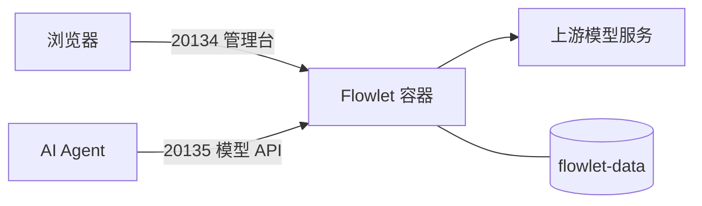

# 用 Docker 部署 Flowlet

用浏览器管理模型账号，让 Agent 调用服务器上的模型 API。首次部署只需 Docker Engine、`docker compose` 和一个客户端可访问的地址；不需要桌面端或 SSO。下面使用仓库的 Compose 文件从源码构建镜像。



## 1. 准备配置

```bash
git clone https://github.com/null-object-0000/flowlet.git
cd flowlet
test -e .env || cp .env.docker.example .env
openssl rand -hex 32
```

在 `.env` 里填两项，其他保持默认。已有 `.env` 就直接编辑，不要替换已有密钥。

| 配置 | 填什么 |
| --- | --- |
| `FLOWLET_ADMIN_TOKEN` | 上面生成的随机字符串，用于登录管理台。 |
| `FLOWLET_PUBLIC_PROXY_URL` | Agent 能访问的模型入口根地址，例如 `http://192.168.1.10:20135`。换成你自己的服务器 IP 或域名，不带 `/v1`。只有 Agent 就在服务器上时才用 `localhost`。 |

> [!IMPORTANT]
> Compose 默认对外绑定这两个端口。HTTP 只用于可信内网；不要把默认 HTTP 端口直接暴露到公网。需要公网访问时，使用 HTTPS 反向代理，并通过防火墙或监听地址限制对源端口的直连。

## 2. 启动并登录

```bash
docker compose up -d --build
docker compose ps
```

在浏览器打开 `http://你的服务器地址:20134`，用 `FLOWLET_ADMIN_TOKEN` 登录。管理台打不开时，先用 `docker compose logs --tail=100 flowlet` 查看原因。

## 3. 接入第一个 Agent

先在管理台添加渠道账号，拉取并勾选要开放的模型。再从概览页复制对应协议的 **Base URL** 和 **客户端 Token**，填到 Agent。不要把管理 Token 或上游 API Key 填给 Agent。

| 客户端使用的协议 | 默认 Base URL（替换为你的服务器地址） |
| --- | --- |
| OpenAI Chat Completions / Responses（无状态） | `http://192.168.1.10:20135/v1` |
| Anthropic Messages | `http://192.168.1.10:20135/anthropic` |

发一条请求，再回「请求日志」确认用的是哪个模型和账号。浏览器版不自动写入本机 Agent 配置。

## 接下来按需阅读

| 我想…… | 看这里 |
| --- | --- |
| 配置 HTTPS、SSO 或登录准入 | [管理端 GitLab OIDC SSO](docker-operations.md#管理端-gitlab-oidc-sso) |
| 改端口、备份数据或升级 | [配置与数据](docker-operations.md#配置与数据) |
| 同步第三方服务凭据到 Agent 机器 | [凭据 CLI](credential-cli.md) |
| 了解 Web 与桌面端的能力差异 | [Web Host 功能范围](docker-operations.md#web-host-功能范围) |

> [!WARNING]
> 账号和日志保存在 `flowlet-data` 卷。升级前先备份完整数据卷，不要用 `docker compose down -v` 来重启。
